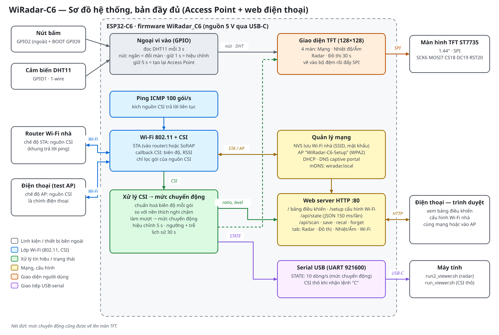

# Sơ đồ hệ thống WiRadar-C6

Các sơ đồ dưới đây được sinh bằng `docs/make_diagrams.py` (chạy lại: `cd docs && ../csi-venv/bin/python make_diagrams.py`).
Có hai định dạng: **SVG** (vector, chèn vào báo cáo không bị vỡ) và **PNG** (độ phân giải gấp đôi) trong `docs/diagrams/`.
Mở `docs/diagrams.html` bằng trình duyệt để xem cả ba.

## 1. Bản đầy đủ: Access Point + web điện thoại (`firmware/WiRadar_C6`)

Luồng chính: router (hoặc điện thoại khi chạy AP) trả lời ping ICMP 100 gói/giây → module Wi-Fi lấy CSI → xử lý CSI ra **mức chuyển động** → hiển thị trên màn TFT, trang web của điện thoại, và gửi dòng `STATE` qua USB cho máy tính.

## 2. Bản chỉ phần cứng (`firmware/WiRadar_C6_Lite`)

Giống bản đầy đủ nhưng **không có Access Point, DNS, mDNS và web server**. Wi-Fi lấy từ bộ nhớ NVS của board (đã lưu bởi bản đầy đủ) hoặc từ `secrets.h`.

## 3. Thao tác nút bấm

Mốc "giữ ≥ 10 s" (đổi chuẩn Wi-Fi 4 ⇄ Wi-Fi 6) là tính năng **sẽ thêm** cho thí nghiệm so sánh; các thao tác còn lại đã có trong firmware. Lưu ý: hiện tại bản đầy đủ tạo lại Access Point ngay lúc đủ 5 giây khi đang giữ, và sẽ chuyển sang thực hiện khi thả nút để nhường mốc 10 giây.

## Các giao thức dùng trong hệ thống
| Lớp | Giao thức | Dùng để |
|---|---|---|
| Liên kết | IEEE 802.11 (CSI) | đo đáp ứng kênh từ các gói nhận được |
| Mạng | IPv4, ICMP | ping 100 gói/giây để nguồn CSI phát liên tục |
| Mạng | DHCP | cấp IP cho board (STA) và cho điện thoại (AP) |
| Ứng dụng | DNS (captive portal), mDNS | trang cấu hình tự bật; địa chỉ `wiradar.local` |
| Ứng dụng | HTTP + JSON | bảng điều khiển và API trên điện thoại |
| Ngoại vi | SPI, 1-wire, UART | màn TFT, DHT11, USB-serial tới máy tính |
