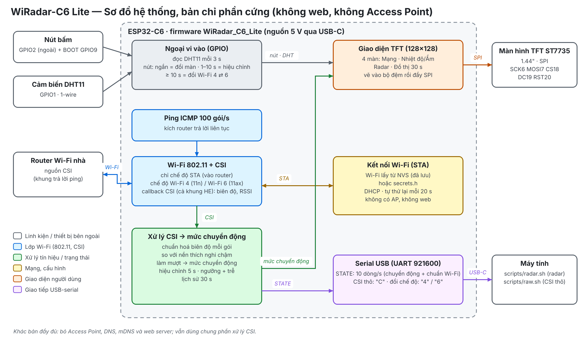
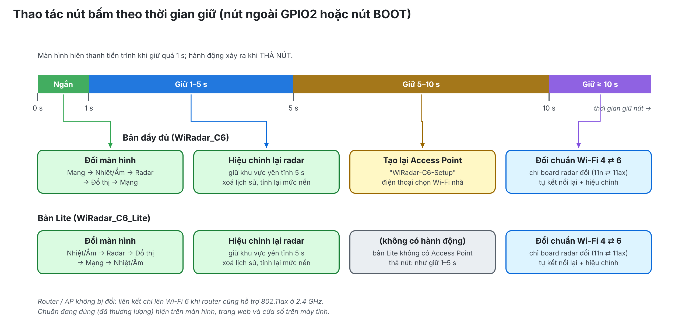

# Sơ đồ hệ thống WiRadar-C6

Các sơ đồ dưới đây được sinh bằng `docs/make_diagrams.py` (chạy lại: `cd docs && ../csi-venv/bin/python make_diagrams.py`; cần `pip install -r viewer/requirements.txt -r viewer/requirements-tools.txt`).
Có hai định dạng: **SVG** (vector, chèn vào báo cáo không bị vỡ) và **PNG** (độ phân giải gấp đôi) trong `docs/diagrams/`.
Mở `docs/diagrams.html` bằng trình duyệt để xem cả ba.

## 1. Bản đầy đủ: Access Point + web điện thoại (`firmware/WiRadar_C6`)

Luồng chính: router (hoặc điện thoại khi chạy AP) trả lời ping ICMP 100 gói/giây → module Wi-Fi lấy CSI → xử lý CSI ra **mức chuyển động** → hiển thị trên màn TFT, trang web của điện thoại, và gửi dòng `STATE` qua USB cho máy tính.

## 2. Bản chỉ phần cứng (`firmware/WiRadar_C6_Lite`)

Giống bản đầy đủ nhưng **không có Access Point, DNS, mDNS và web server**. Wi-Fi lấy từ bộ nhớ NVS của board (đã lưu bởi bản đầy đủ) hoặc từ `secrets.h`.

## 3. Thao tác nút bấm

Mọi thao tác xảy ra khi **thả nút**, màn hình hiện thanh tiến trình và việc sẽ làm. Mốc ≥ 10 s đổi chế độ liên kết **Wi-Fi 4 (802.11n) ⇄ Wi-Fi 6 (802.11ax)** của board radar; router/AP không bị đổi. Chế độ cũng đổi được từ máy tính (phím `4` / `6` trong cửa sổ radar, hoặc `--wifi 4|6`) và từ trang web.

## Cấu trúc mã firmware
| Module | Vai trò | Dùng ở |
|---|---|---|
| `config.h` | chân GPIO, ngưỡng radar | cả hai |
| `csi_math.h` | biên độ, chuẩn hoá, đường nền, trung vị: **số nguyên** (C6 không có FPU), không phụ thuộc Arduino nên test được trên PC | cả hai |
| `csi_core.h` | callback CSI, ping, hiệu chỉnh (trung vị 5 s), phát hiện có trễ, sàn thích nghi chậm, lịch sử 30 s (bộ đệm vòng) | cả hai |
| `wifi_mode.h` | chọn Wi-Fi 4 / 6, đọc chuẩn đang dùng | cả hai |
| `tft_ui.h` | các màn Nhiệt/Ẩm, Radar, Đồ thị, gương màn hình, màn chào | cả hai |
| `climate.h` | DHT11 đọc trong task riêng | cả hai |
| `WiRadar_C6.ino` | AP cấu hình, DNS, mDNS, web, nút (có mốc 5 s tạo AP) | bản đầy đủ |
| `WiRadar_C6_Lite.ino` | chỉ nối router, màn Mạng, nút | bản Lite |

Bản Lite dùng **bản chép** của các header dùng chung (Arduino chỉ thấy file trong thư mục sketch). Sửa ở `firmware/WiRadar_C6/`
rồi chạy `python3 scripts/sync_shared.py`; CI báo lỗi nếu quên.

## Chế độ Wi-Fi 4 / Wi-Fi 6
- **Board khai báo** khả năng của mình khi kết nối: Wi-Fi 4 = 11b/g/n, Wi-Fi 6 = 11b/g/n/ax. Liên kết chỉ lên 802.11ax khi **router/AP cũng hỗ trợ**.
- **Chuẩn đang dùng** được đọc từ chuẩn đã thương lượng (phía kết nối) hoặc từ định dạng các khung nhận được (phía AP), và hiện kèm bộ đếm khung HE / HT / legacy mỗi giây.
- CSI của khung HE được thu bằng `acquire_csi_su`; mỗi độ dài CSI có nền riêng để so sánh khung khác định dạng.

## Các giao thức dùng trong hệ thống
| Lớp | Giao thức | Dùng để |
|---|---|---|
| Liên kết | IEEE 802.11 (CSI) | đo đáp ứng kênh từ các gói nhận được |
| Mạng | IPv4, ICMP | ping 100 gói/giây để nguồn CSI phát liên tục |
| Mạng | DHCP | cấp IP cho board (STA) và cho điện thoại (AP) |
| Ứng dụng | DNS (captive portal), mDNS | trang cấu hình tự bật; địa chỉ `wiradar.local` |
| Ứng dụng | HTTP + JSON | bảng điều khiển và API trên điện thoại |
| Ngoại vi | SPI, 1-wire, UART | màn TFT, DHT11, USB-serial tới máy tính |
